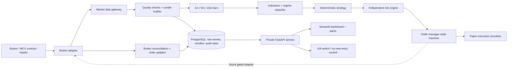

# Stage 1: Research, Feasibility, and Implementation Plan

**Prepared:** 20 November 2026  
**Scope:** Planning and repository review only. No application code has been changed.  
**Status:** Ready for review; live execution is out of scope until broker and compliance gates are cleared.

## Executive summary

The project has a useful deterministic strategy and paper-trading foundation, plus an initial Shoonya REST/WebSocket adapter. It is not ready for live use. The main blockers are lifecycle and persistence (paper “fills” are not position management), strategy scope (only a single candle series is used), incomplete broker API alignment and reconciliation, outdated risk defaults relative to the requested 0.5%/2%, and an unsettled regulatory/broker onboarding path.

Shoonya is the only currently plausible first broker in the requested list: its official API docs describe MCX as a supported exchange segment, REST order management, historical/time-series data, and WebSocket prices and order updates. That is API-level feasibility only. The specific account must have MCX/API permissions and the broker must confirm the retail-algo enrollment, static egress IP, algo identification, and current order controls. Groww’s current API docs explicitly say commodity trading through its API is not supported; do not build a Groww MCX adapter unless that changes in official docs.

The system should be built in gated increments, beginning with read-only market-data validation and event-driven backtesting. No strategy should progress to paper trading until its data coverage, cost model, and out-of-sample results are adequate. No live mode should be implemented or enabled until broker/compliance approval, order-state reconciliation, protective-order behavior, and operational recovery have been proven.

## Verified facts and assumptions

### Verified from current official documentation

- Shoonya documents REST and WebSocket APIs, OAuth 2.0 authentication, and MCX as an exchange segment. The API describes limit and stop-loss-limit order types; market, cover, and bracket orders are not supported on its Place Order endpoint. Orders must be tracked through asynchronous lifecycle updates and reconciled against broker books. See [Shoonya API introduction](https://www.shoonya.com/api-documentation), [Place Order](https://www.shoonya.com/api-documentation/place-order), [WebSocket overview](https://www.shoonya.com/api-documentation/websocket-overview), and [Order Update Feed](https://www.shoonya.com/api-documentation/order-update-feed).
- Shoonya advises streaming rather than tight REST polling and documents approximate limits around 10 order operations/second per user, one market-data REST request/second/instrument, and one WebSocket connection/session. Limits may change; the adapter must consume current broker limits and handle throttling. See [Shoonya rate limits](https://shoonya.com/api-documentation/rate-limits).
- Shoonya’s docs expose historical and intraday OHLCV APIs, including TPSeries intervals, but do not establish that the data has enough depth, completeness, timestamp quality, or licensing for robust backtests. See [Time/Price Series](https://shoonya.com/api-documentation/time-price-series) and [API terms](https://www.shoonya.com/api-terms-and-conditions).
- Groww’s official API guide currently states that its API supports CASH and FNO, not MCX commodity trading. See [Groww API introduction](https://groww.in/trade-api/docs/curl) and [user API documentation](https://groww.in/trade-api/docs/curl/user).
- SEBI’s retail-algo circular (4 February 2025) sets requirements including exchange-provided identifiers on API algo orders, static-IP whitelisting, OAuth and two-factor authentication, and exchange registration for self-developed algos above the applicable order-rate threshold. A September 2025 SEBI extension states the framework applies to all stock brokers from 1 April 2026; that date has passed. Current exchange implementation standards and the application of each requirement to MCX commodity orders must be confirmed with Shoonya and the relevant exchange before execution. See [SEBI circular](https://www.sebi.gov.in/legal/circulars/feb-2025/safer-participation-of-retail-investors-in-algorithmic-trading_91614.html) and [SEBI implementation timeline extension](https://www.sebi.gov.in/sebi_data/attachdocs/sep-2025/1759232056254.pdf).
- MCX publishes contract-specific specifications and lists multiple variants (e.g., Crude Oil/Crude Oil Mini, Gold/Gold Mini/Gold Ten, Silver/Silver Mini/Silver Micro). Lot size, tick, expiry, delivery terms, and trading conditions vary by contract and can change. Resolve live contracts from broker/exchange masters and current MCX specifications; never rely on a fixed lot-size assumption. See [MCX Crude Oil](https://www.mcxindia.com/products/energy/crude-oil), [MCX Gold](https://www.mcxindia.com/en/products/bullion/GOLD), and [MCX Silver](https://beta.mcxindia.com/products/bullion/silver).

### Assumptions for planning (must be confirmed)

- Initial account is a single individual retail account, not a multi-client/vendor platform.
- Initial scope is intraday futures only. Options and delivery are excluded.
- Starting risk targets are 0.5% of allocated capital per trade, 2% daily stop, and 3 consecutive losses, subject to actual account capital, costs, minimum lot, and broker risk controls.
- The initial release is research/backtest and paper mode. It has no live order path.
- The dashboard is local/private initially; publishing live market data to third parties is excluded pending license review.

## Repository review (static review; no tests run)

### Existing strengths

- The code is separated into broker-neutral instrument/order types, market structures, indicators, strategy, risk sizing, order lifecycle, paper broker, and Shoonya adapter.
- `Decimal` is used for price/risk arithmetic; the current engine defaults to paper mode and live entries disabled.
- The strategy uses prior candles for its swing boundary and relative-volume baseline, and the market-quality helper rejects stale/future ticks.
- The repository includes tests for strategy, risk, execution, engine, and Shoonya behavior. Tests were not run during this planning stage.

### Blocking gaps before any paper/live rollout

1. **Risk defaults conflict with the requested specification.** `RiskLimits` currently defaults to 2% per trade and 5% daily loss, not 0.5% and 2%. Aggregate exposure, margin headroom, max slippage, and realized plus unrealized daily loss are not enforced as a unified pre-order check.
2. **Paper execution is a fill stub.** `PaperBroker.place_order()` immediately returns a synthetic fill; there is no resting order, partial fill, order book, stop/target/trailing management, exit, fee model, missed trade, or position ledger. `TradingEngine.evaluate()` can issue repeated entries and does not track whether an instrument is already held.
3. **No durable state or recovery.** Lifecycle history and market series are in memory. A restart cannot reconcile intents, fills, protective orders, positions, or daily limits.
4. **Strategy does not implement the requested timeframes.** The signal engine operates on one candle series and does not build or align 5-minute/15-minute confirmation. VWAP uses the complete supplied candle sequence, not a session-reset series. There is no session calendar, exchange holiday handling, or expiry/rollover boundary logic.
5. **Historical tests cannot establish realistic performance yet.** The repo has no event-driven backtester, point-in-time contract master, bid/ask/spread model, statutory fee schedule, realistic fill/partial-fill logic, or chronologically separated out-of-sample workflow.
6. **Broker adapter is a prototype requiring doc-by-doc reconciliation.** It should be checked against the current official payloads, OAuth flow, token/session lifecycle, field names, MCX product permissions, stop trigger behavior, and responses. The local limiter is hard-coded and must not be treated as the broker’s current contractual quota. The WebSocket wrapper has no reconnect/backoff/resubscribe loop or message queue. Submission acknowledgment must never be interpreted as a fill.
7. **Contract metadata can be guessed by CLI defaults.** Paper script defaults to lot size 10 and tick/multiplier 1; that is unsafe for real MCX contracts. Production calculations must use validated, dated contract metadata and reject stale/unknown masters.
8. **Sensitive configuration needs review.** `.env` exists locally; its contents were not opened or copied. Confirm it is ignored by Git, rotate any exposed credentials, and avoid printing tokens in logs or command output.

These are review findings, not claims that the current tests fail. The user’s request to “fix the code completely” conflicts with the pasted immediate instruction to complete and review Stage 1 before coding. Implementation is therefore deferred until the architecture and plan are reviewed.

## Proposed architecture

### Module responsibilities

| Module | Responsibility |
|---|---|
| `config` | Typed settings, validation, environment loading, safe secret handling; mode must default to research/paper. |
| `broker` | Protocols and broker-neutral contract, order, fill, position, and margin models. |
| `broker/shoonya` | OAuth/session, instrument master/search, streaming, REST requests, throttling, response normalization, and reconciliation. No strategy logic. |
| `market_data` | Tick ingestion, timestamp normalization, duplicate/out-of-order checks, freshness guard, session-aware 1m candles and 5m/15m aggregation. |
| `indicators` / `volatility_detection` | Causal ATR and baseline, session VWAP, relative volume, momentum, breakout strength, regime classification. |
| `strategies` | Deterministic long/short signal generation with versioned configuration and explainable rejection reasons. |
| `risk` | Independent final gates: capital, stop risk, costs, lots, margin, slippage, per-instrument/aggregate positions, daily loss, trade count, loss streak, cooldown, kill switch. |
| `execution` | Idempotent order intents, state transitions, partial fills, cancel/replace, protective stop workflow, emergency exit, and order reconciliation. |
| `paper_trading` | Event-driven fill simulator with spread/slippage/costs, liquidity limits, partials, stops/targets, and full position accounting. |
| `backtesting` | Chronological event simulation, contract/expiry roll handling, costs, metrics, walk-forward/out-of-sample evaluation. |
| `database` | PostgreSQL persistence, migrations, immutable audit events, restart recovery. Redis only if measured latency/state needs justify it. |
| `dashboard` / `monitoring` | Private status, signal rationale, positions, limits, P&L, data age, connection health, audit trail, alerts, no-new-entry toggle. |
| `tests` | Unit, property, integration-with-mocks, replay, and fault-injection coverage. |

## Strategy specification for research (not a validated profitable strategy)

1. **Inputs:** exchange/broker ticks with exchange timestamps, trade volume, bid/ask or depth where available, dated contract metadata, and exchange session calendar. Build closed 1-minute bars; derive aligned 5-minute and 15-minute bars using only fully closed bars.
2. **Movement and momentum:** calculate 1m/3m/5m returns and acceleration, directional candle count, and close location. Compare movement to rolling ATR and robust historical return/range distributions per contract and time-of-day bucket; avoid fixed rupee thresholds.
3. **Volatility:** Wilder ATR on causal closed bars; compare current ATR to a trailing median/mean baseline excluding the current observation. Proposed labels: contraction below configurable baseline ratio; normal; increasing volatility; directional breakout when a confirmed range break also passes momentum/volume/context filters; chaotic when extreme range/ATR, reversal, crossed/stale feed, or spread/liquidity quality fails. Exact thresholds are research parameters, not final constants.
4. **Volume and liquidity:** compare current completed bar volume against prior same-session/time-of-day observations where sufficient history exists. Require minimum liquidity and maximum spread/depth deterioration; missing or unreliable volume means no signal.
5. **VWAP and multi-timeframe context:** reset VWAP at the exchange session boundary. Longs require close above session VWAP and bullish 15m context by default; shorts require the inverse. A 5m closed-bar breakout beyond the prior N completed bars confirms direction; 1m bar triggers only if breakout has not already become overextended.
6. **Entry:** require the above plus fresh data, valid contract, no position/open entry for the contract, no cooldown, risk approval, and permissible execution price. Use exchange-permitted limit or stop-limit orders after broker confirms accepted fields and trigger behavior. No market-order workaround.
7. **Stops and exits:** initial stop uses a configurable ATR distance and structural invalidation, selecting the wider stop only if position size still fits risk; target is configurable reward:risk. Trail only after a defined favorable excursion. Exit on stop/target, opposite confirmed momentum, time stop, end-of-session cutoff, data/broker safety failure, or max holding time. Never carry overnight.
8. **False breakout controls:** require completed-candle close, a volume/liquidity check, max distance from VWAP, bounded entry chase, and either a short persistence/retest rule or strict close confirmation. Compare variants using walk-forward tests; no hand-picked best historical setting.
9. **No look-ahead:** decisions at bar close can use that bar only after it closes. Orders fill no earlier than the next available event at modeled executable bid/ask, with adverse slippage and partial fills where data permits.

## Risk specification

- Initial proposed risk: 0.5% of allocated capital per trade; daily stop 2%; stop new entries after 3 consecutive losses. All settings configurable and validated.
- Size in whole lots only: `floor(per_trade_budget / (stop_points × contract_value_per_point × lots + fees + spread + adverse_slippage))`, then constrain by free margin, exposure, max position, and order quantity limits. If one lot breaches the budget, reject.
- Include exchange/broker brokerage, exchange transaction charges, SEBI charges, GST, stamp duty, and applicable commodity-specific levies using an effective-dated fee schedule; verify rates before each release.
- Daily loss uses realized plus conservative unrealized P&L and costs. Enforce max trades/day, one active position per contract initially, aggregate exposure, maximum slippage, no averaging down/martingale, no overnight hold, and explicit kill switch.
- Apply gates again immediately before each order submission and on modifications that increase risk. Broker positions and orders take precedence over local display state during reconciliation.
- Protective stop placement failure after a fill triggers immediate emergency procedure and alarm; do not silently retry indefinitely.

## Data and database design

Use PostgreSQL as the authoritative durable store; keep raw broker events and audit records append-only. Redis is optional and not in the first implementation.

| Entity | Key fields / purpose |
|---|---|
| `instruments` | exchange, token, symbol, underlying, variant, expiry, lot size, multiplier, tick, quantity/freeze limit, effective-from/to, source, fetched-at. |
| `market_events` | instrument, source event id, exchange/receive timestamps, LTP, bid/ask/depth, cumulative volume, raw payload reference/hash; dedupe and quality audit. |
| `bars` | instrument, interval, session date, bar timestamp, OHLCV, completeness/quality flags; unique `(instrument, interval, timestamp)`. |
| `strategy_configs` | immutable version, parameters, code version/hash, approval metadata. |
| `signals` | config version, instrument, decision timestamp, direction, feature snapshot, reason, accepted/rejected status. |
| `risk_decisions` | signal/order intent, capital snapshot, calculated quantity/loss/margin/cost estimate, every gate result. |
| `order_intents` | unique client intent ID, signal ID, broker, side, quantity, limit/trigger, state, idempotency key. |
| `broker_orders` / `fills` | broker order IDs, updates, cumulative fill, fill price/time, fees, rejection text; immutable event history. |
| `positions` | instrument, net quantity, average price, protective order IDs, realized/unrealized P&L, lifecycle status, broker reconciliation timestamp. |
| `daily_risk` | trade date, realized/unrealized P&L, drawdown, loss streak, trade count, lock state. |
| `audit_events` | actor/process, event type, correlation ID, timestamp, before/after state, redacted details. |

## Broker feasibility and API requirements

### Shoonya (candidate; conditional)

- Officially documents MCX segment code, Place/Modify/Cancel, order/trade/position/limits endpoints, Search Scrip/Security Info, historical and intraday candles, WebSocket touchline and order updates. Verify each exact operation and current request schema against live official docs before adapter implementation.
- Place Order documentation supports LMT and SL-LMT and disallows MKT, CO, and BO. This makes price protection and fill risk materially different from a market-order model. The stop order is not guaranteed to fill at its trigger price; use emergency state handling and conservative simulation.
- Confirm whether the current account/API uses the documented OAuth-only flow, 2FA, static IP, unique API credentials, algo IDs/tags, and MCX permissions. Do not infer account-level access from the generic docs.
- Historical candles may be intraday/short-lookback and may not support a statistically useful multi-year MCX backtest. Obtain a data sample and confirm licensed historical depth before building backtest expectations.
- Adapter prerequisites: current instrument master ingestion, time/price-zone tests, endpoint schemas, retry-safe error taxonomy, rate limits, WebSocket queue and reconnect/resubscribe, token expiry, order-update dedupe, periodic order/position reconciliation, and documented operator runbook.

### Groww

Do not include in initial scope: the current official Groww API guide says MCX is unavailable via the API. Reassess only after its docs explicitly add MCX and specify order types, streaming, historical coverage, and compliance operations.

### Regulatory and operational gate

SEBI’s framework rollout date of 1 April 2026 has passed. Before any live integration, obtain written broker guidance on whether this individual retail commodity strategy needs exchange registration/tagging based on order rate, what API mode and static-IP controls apply, how algo IDs are supplied, which order types/products are permitted, and how MCX/exchange-specific circulars modify the general requirements. This plan does not substitute for broker compliance advice. Do not bypass a broker restriction.

## Failure modes and mitigations

| Failure | Required behavior |
|---|---|
| Stale, out-of-order, duplicate, or implausible market data | Mark feed unhealthy; block entries; preserve existing protective monitoring; reconcile when restored. |
| WebSocket drop/session expiry | Exponential backoff with jitter; authenticate; resubscribe; wait for fresh data; reconcile open orders and positions before resuming. |
| Submission timeout/ambiguous acknowledgment | Query by idempotency/client reference and reconcile before retry; prevent duplicate orders. |
| Partial fill, cancel race, or rejected order | Update only from order events/books; protect filled quantity; reconcile residual quantity before further action. |
| Stop placement/modify failure | Alert and issue predefined emergency exit workflow; verify actual broker position until flat/protected. |
| Process restart | Load durable intents/events; reconcile broker first; block new entries until all unknowns resolved. |
| Wrong/stale contract master or expiry | Fail closed; validate date, lot, tick, multiplier, expiry and trading status against current source. |
| Daily loss/risk calculation divergence | Broker and persisted fills are source data; block entries on missing fees/position state or disagreement. |
| API rate limit/outage | Prioritize exit/protection and reconciliation calls; backoff; block new entries; alert operator. |
| Dashboard/API compromise | Local bind/authentication, least privilege, no secret exposure, audit control changes; live activation separately gated. |

## Backtesting and validation plan

1. Audit data completeness, session boundaries, contract expiry/roll, duplicate bars, volume meaning, timestamps, and survivorship/selection bias for each instrument/variant.
2. Use event-driven replay with only information available at each timestamp. Model limit/stop-limit execution, spread, slippage, transaction costs, latency, rejection, and partial fills; disclose assumptions when historical order book data is unavailable.
3. Split chronologically into training, validation, and untouched out-of-sample periods; use rolling/walk-forward folds. Keep parameter search bounded and report all tested variants to reduce selection bias.
4. Test Crude Oil, Gold, and Silver contracts independently before pooled portfolio tests; separately report variant and time-of-day results.
5. Report trades, win rate, expectancy, profit factor, max drawdown, Sharpe, average win/loss, realized costs/slippage, time in market, exposure, and regime/time-of-day breakdown. Include confidence/sample-size caveats and negative or inconclusive results.
6. Predefine acceptance limits before tuning: positive out-of-sample net expectancy after all costs, drawdown within approved risk, no single period/contract dominating results, stable behavior under increased costs/slippage, sufficient independent trades, and zero invariant violations. Exact thresholds require owner review.
7. Paper trading then compares generated decisions to broker data in real time without submitting orders. Verify data health, cost assumptions, signal frequency, missed opportunities, order-state simulation, and daily reconciliation over a pre-agreed observation period.

## Development roadmap

| Stage | Deliverables | Exit gate |
|---|---|---|
| 1. Research and plan | This architecture, feasibility report, strategy/risk specification, schema, risks, roadmap, open decisions. | Owner reviews the plan; broker/regulatory questions are assigned. |
| 2. Foundation and market data | Typed config, broker-neutral types, Shoonya read-only auth/contract master/data adapter, stream ingestion, candle generation, persistence, quality checks. | Contract/data reconciliation and reconnect replay pass; no trading endpoint used. |
| 3. Strategy | Causal indicators, 1m/5m/15m alignment, regime, long/short signals and explanations. | Unit/property tests and no-look-ahead review pass. |
| 4. Risk and paper execution | Independent risk engine, durable order state machine, fees/slippage/partial fills, stops/exits, recovery and fault injection. | Safety invariants and broker-mock failure scenarios pass. |
| 5. Backtesting | Historical ingestion/validation, event-driven engine, cost model, walk-forward and per-contract reporting. | Predefined out-of-sample criteria pass; otherwise revise/reject strategy. |
| 6. Paper trading | Live read-only market data, simulated execution, reconciliation and analytics. | Agreed observation window and stability criteria pass. |
| 7. Dashboard/deployment | Private dashboard, alerts, deployment hardening, backups, monitoring, static IP and operator runbooks. | Security/compliance and recovery review pass. |
| 8. Controlled live (separate approval) | Only after broker/exchange clearance, explicit user authorization, minimal quantity, strict limits and active monitoring. | Explicit live enablement and kill-switch rehearsal. |

## Testing strategy

- Unit tests: indicator causality/session reset, regime boundaries, order quantity/lot calculations, costs, risk gates, lifecycle transition validity, idempotency, and stale data.
- Property tests: no accepted size exceeds risk budget; long/short protective stops are on valid sides; no signal uses future bars; duplicate broker events do not duplicate fills.
- Integration tests with recorded fixtures/mocks: Shoonya schemas, throttling, token expiry, REST failures, WebSocket disconnect/reconnect/resubscribe, order updates, partial fills, and reconciliation discrepancies.
- Replay/fault tests: restart at every order state, stop failure, cancel/fill race, delayed/stale ticks, rate limiting, process death, and daily-loss lock.
- Backtest validation: synthetic edge cases plus independently sourced dated contracts and strictly chronological out-of-sample replay.
- Deployment checks: secrets absent from logs/artifacts, `.env` ignored, dashboard access constrained, database backup/restore, and static-IP checks.

## Technical complexity and dependencies

Moderate-to-high. The strategy calculations are straightforward compared with correct execution, market-data quality, effective-dated contract metadata, fees, durable recovery, and regulatory onboarding. Start with Python 3.11+, current supported versions of `websocket-client`, `python-dotenv`, and pytest; add PostgreSQL driver/migrations, FastAPI, and Streamlit only in their relevant stages. Pandas/NumPy are optional until batch research proves they simplify data workflows; keep core accounting decimal-safe. Redis and Docker are deferred until operational requirements justify them.

## Unresolved questions for review

1. Which exact futures variants should be considered first for each underlying (standard vs mini/micro), and should expiry month selection be nearest liquid contract or operator-selected?
2. What is the allocated capital and is ₹40,000 in the current README representative? At that amount, one-lot risk and margin may reject most standard contracts; the system must fail closed.
3. Is the account solely the user's individual account? Is the bot strictly private, with no signals/orders offered to anyone else?
4. Has Shoonya confirmed in writing MCX API access, OAuth/2FA, static-IP whitelisting, algo tagging/ID, supported MIS/NRML products, stop-limit behavior, and the applicable order-rate threshold for MCX?
5. What licensed historical source and depth are available? Shoonya TPSeries alone may be insufficient for robust multi-year research.
6. Should the initial dashboard remain local-only, and what alert channel is desired?
7. What observation period and objective acceptance criteria should be required for paper trading and any later live approval?

## Stage 1 progress checklist

- [x] Inspect existing project structure and README.
- [x] Review existing strategy, risk, paper execution, and Shoonya adapter statically.
- [x] Research current official broker, SEBI, and MCX sources.
- [x] Define proposed architecture, strategy research rules, risk controls, database entities, tests, failure handling, and roadmap.
- [ ] Owner review and decisions on unresolved questions.
- [ ] Only after review: begin Stage 2 implementation in a separate approved work step.

